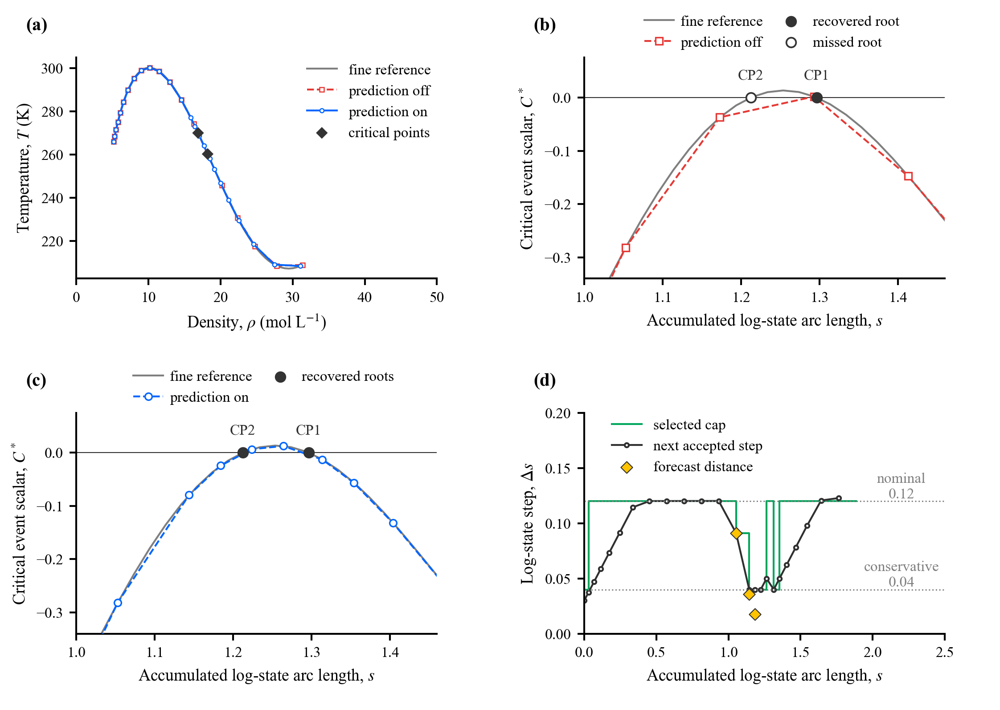
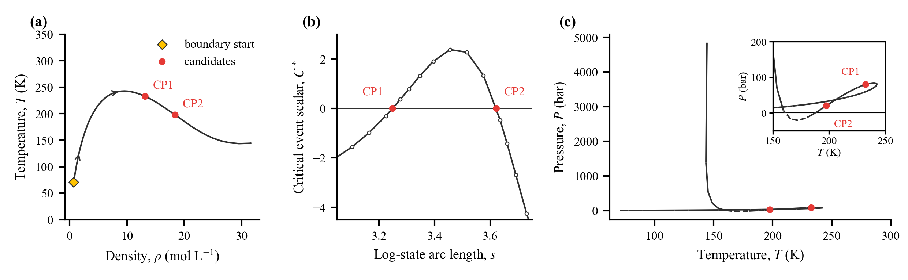
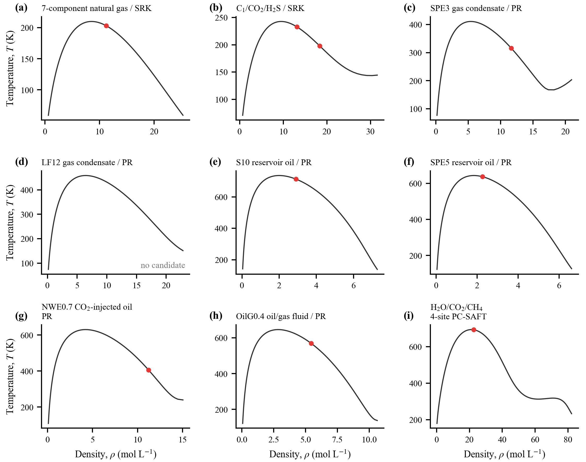
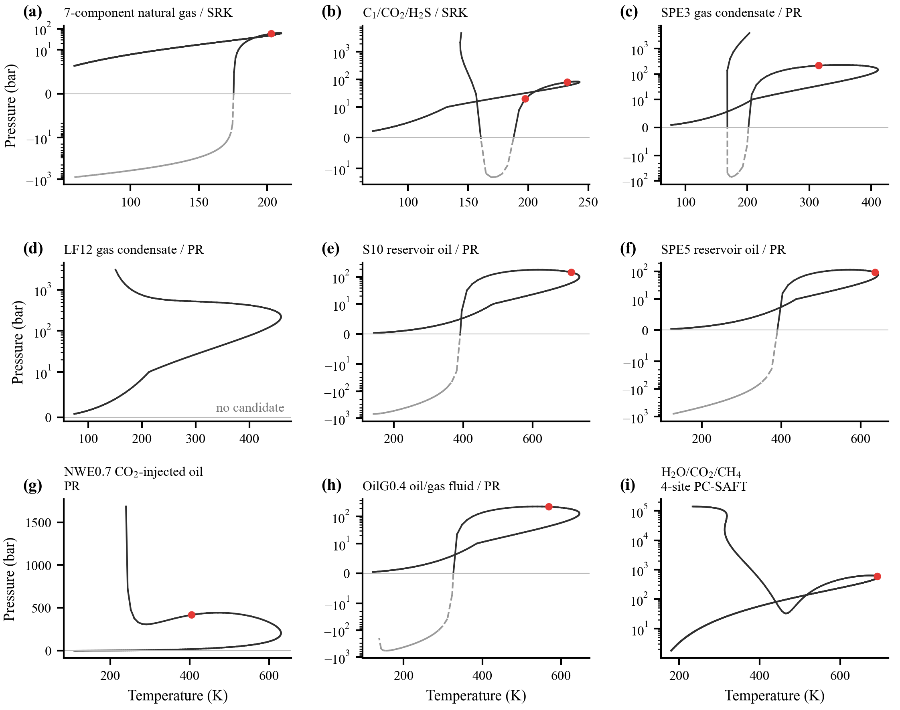

<div align="center">

<h1>HelmholtzCP Cubic</h1>

<p><strong>Mixture critical points from Helmholtz free energy</strong></p>

<p><strong>English</strong> | <a href="README.zh-CN.md">简体中文</a></p>

<p>
  <a href="#quick-start"></a>
  <a href="#quick-start"></a>
  <a href="#other-helmholtz-models"></a>
  <a href="#run-the-examples"></a>
</p>

<p>
  <a href="#basic-theory">Basic theory</a> &middot;
  <a href="#quick-start">Quick start</a> &middot;
  <a href="#run-the-examples">Examples</a> &middot;
  <a href="#representative-results">Results</a> &middot;
  <a href="#other-helmholtz-models">Other EOS models</a> &middot;
  <a href="#documentation">Documentation</a>
</p>

</div>

## Overview

**HelmholtzCP Cubic** discovers critical-point candidates at a prescribed mixture composition and assesses their thermodynamic stability. It combines adaptive initialization, predictive spinodal continuation, critical-point correction and tangent-plane-distance (TPD) screening.

The method is formulated in terms of Helmholtz free-energy density and can be applied to other differentiable Helmholtz-based equations of state through the model interface. **This public distribution supplies the Peng–Robinson (PR) and Soave–Redlich–Kwong (SRK) models**, together with 22 runnable paper examples. See [Other Helmholtz models](#other-helmholtz-models) for the extension requirements.

| Stage | What the package does |
| :--- | :--- |
| **Initialize** | Locates spinodal intersections with the edges of the specified search region to generate starting points. |
| **Trace** | Follows spinodals with predictive step control to identify critical-point candidates. |
| **Correct** | Solves the criticality conditions using trust-region correction. |
| **Screen** | Applies local fourth-order analysis and TPD screening to the recovered candidates. |

## Basic theory

The model supplies the Helmholtz free-energy density $\Psi=A/V$ at component densities $\boldsymbol\rho=\rho\mathbf z$, where $\rho$ is the total molar density and $\mathbf z$ the prescribed mole-fraction vector. The PR/SRK forms follow Bell and Jäger (2016), with chemical potentials and pressure obtained by differentiation.

Let $H_{ij}=\partial^2\Psi/\partial\rho_i\partial\rho_j$ at fixed temperature $T$ and $M=\rho H/(RT)$, with gas constant $R$. For a simple zero eigenvalue of $M$, ordinary critical-point candidates satisfy the conditions of Heidemann and Khalil (1980) and Bell and Jäger (2017):

$$
\begin{aligned}
q^* &= \lambda_{\min}(M)=0, \\
C^* &= \frac{\rho^2}{RT}\left.\frac{\mathrm d^3\Psi(T,\boldsymbol\rho+s\mathbf u)}{\mathrm ds^3}\right|_{s=0}=0,
\end{aligned}
$$

where $\mathbf u$ is the unit eigenvector associated with $\lambda_{\min}(M)$ and $s$ is a scalar density perturbation along that direction. The search follows the spinodal $q^*=0$ and locates zeros of $C^*$. Local fourth-order analysis characterizes the critical structure (Michelsen, 1984), and TPD screening assesses thermodynamic stability (Michelsen, 1982). The [method guide](docs/Method.md#2-equations-and-units) gives the thermodynamic relations, numerical settings and references.

## Quick start

Requires **Python 3.11 or later**. NumPy, SciPy and PyTorch are declared dependencies and are installed as needed by `pip`.

```bash
git clone https://github.com/zhengbaofang/HelmholtzCP-Cubic.git
cd HelmholtzCP-Cubic
python -m pip install ".[plot]"
python examples/C1C2_PR.py
```

This runs the methane–ethane PR example, prints the critical points and their TPD status, and saves a spinodal plot to `output/C1C2_PR.png`.

## Run the examples

The **22 fixed-composition cases** span binary mixtures, sour gases, natural gases, gas condensates and reservoir oils, with **2–12 components**. Each case has its own Python script containing the fluid properties, composition, interaction parameters, search settings, units and sources.

Run these commands from the repository root after installation:

| Task | Command |
| :--- | :--- |
| Methane–ethane with PR | `python examples/C1C2_PR.py` |
| Methane–hydrogen sulfide with SRK | `python examples/C1H2S_SRK.py` |
| An NWE composition variant | `python examples/NWE_O1.py` |
| Optional batch run with result export | `python -m examples.RunPaperCases C1C2_PR NaturalGas7` |

Open a case script to edit its inputs and step settings, then run that file directly. Each script displays the calculation sequence, prints temperature, pressure, molar density and TPD status in **K, bar and mol/L**, and saves a two-panel PNG to `output/<case>.png`. No JSON input or shared fluid-data loader is required. The optional batch runner exports full result records and accepts `--all` or `--output`; see the [example guide](docs/Examples.md#optional-batch-export).

See the [complete example catalogue](docs/Examples.md) for mixture definitions and output fields, or the [Python API](docs/Method.md#5-python-api) to supply your own mixture.

## Representative results

### Two nearby critical-point candidates

Methane–hydrogen sulfide with SRK illustrates predictive step control and the recovery of two nearby candidates. The corresponding example is `C1H2S_SRK`.

<p align="center">
  
</p>

### A multicomponent sour gas

Methane–carbon dioxide–hydrogen sulfide with SRK illustrates automatic initialization, spinodal tracing and critical-point correction. The corresponding example is `SourGas3`.

<p align="center">
  
</p>

The figures are from the accompanying manuscript. The scripts calculate numerical results; publication layouts and the separate step-size comparisons shown above were prepared separately.

### Additional mixtures and EOS models

Supplementary Figs. S1 and S2 show the same nine fixed-composition calculations in density–temperature and pressure–temperature coordinates. Panels **(a)–(b) use SRK** and **(c)–(h) use PR**. Panel **(i) uses four-site PC-SAFT** for water–carbon dioxide–methane, illustrating application of the method to an associating mixture. **The PC-SAFT implementation is not included in this public PR/SRK package.**

**Supplementary Fig. S1.** Density–temperature spinodals. Red circles mark critical-point candidates.

<p align="center">
  <a href="docs/figures/FigS1.png"></a>
</p>

**Supplementary Fig. S2.** Pressure–temperature projections of the same spinodals, in the same panel order. Red circles mark critical-point candidates. Dashed segments indicate negative-pressure extensions.

<p align="center">
  <a href="docs/figures/FigS2.png"></a>
</p>

## Other Helmholtz models

To use another EOS, implement the [`FreeEnergyModel`](src/HelmholtzCPCubic/Common/Model.py) interface with:

1. **Differentiable free energy.** Supply the total ideal and residual Helmholtz free-energy density in PyTorch, preserving the temperature and component-density dependence needed for derivatives through fourth order.
2. **Model parameters and scales.** Define the component count, gas constant, characteristic temperature and density, and unit conversions.
3. **Thermodynamic domain.** Provide appropriate state checks, density bounds and a consistent ideal-gas chemical-potential reference.

The generic `backend="ad"` then evaluates the critical conditions from that model. Additional EOS implementations and their parameter data must be supplied separately; PR and SRK are the models included here.

## Documentation

| Guide | Contents |
| :--- | :--- |
| [Method and Python API](docs/Method.md) | Formulation, numerical settings, TPD objective, architecture and API usage. |
| [Example catalogue](docs/Examples.md) | All 22 cases, input conventions, commands and result fields. |
| [Validation record](docs/Development.md) | Input equivalence, representative numerical comparisons and the known expected-failure test. |
| [Sources and notices](references/NOTICE.md) | Data provenance and third-party attribution. |
| [Selected references](#references) | Foundational work on critical conditions, stability and Helmholtz formulations. |

## Tests and optional backends

### Run the included tests

```bash
python -m pip install ".[test]"
python -m pytest -q
```

The default test selection excludes the full-search test marked `slow`. The [validation record](docs/Development.md#retained-checks-and-known-baseline-failure) describes the retained expected-failure case and the representative calculations already checked.

### Select a derivative backend

Critical-point correction uses automatic differentiation by default. PR/SRK also support analytic and multicomplex derivatives through `CriticalPointSolver(..., backend="analytic")` or `backend="pymcx"`. Install the optional multicomplex dependency with:

```bash
python -m pip install ".[pymcx]"
```

Backend choices and their scope are described in the [Python API guide](docs/Method.md#5-python-api).

## References

1. Heidemann, R. A., & Khalil, A. M. (1980). The calculation of critical points. *AIChE Journal*, **26**(5), 769–779. [DOI: 10.1002/aic.690260510](https://doi.org/10.1002/aic.690260510).

2. Michelsen, M. L. (1982). The isothermal flash problem. Part I. Stability. *Fluid Phase Equilibria*, **9**(1), 1–19. [DOI: 10.1016/0378-3812(82)85001-2](https://doi.org/10.1016/0378-3812%2882%2985001-2).

3. Michelsen, M. L. (1984). Calculation of critical points and phase boundaries in the critical region. *Fluid Phase Equilibria*, **16**(1), 57–76. [DOI: 10.1016/0378-3812(84)85021-9](https://doi.org/10.1016/0378-3812%2884%2985021-9).

4. Bell, I. H., & Jäger, A. (2016). Helmholtz energy transformations of common cubic equations of state for use with pure fluids and mixtures. *Journal of Research of the National Institute of Standards and Technology*, **121**, 238–263. [DOI: 10.6028/jres.121.011](https://doi.org/10.6028/jres.121.011).

5. Bell, I. H., & Jäger, A. (2017). Calculation of critical points from Helmholtz-energy-explicit mixture models. *Fluid Phase Equilibria*, **433**, 159–173. [DOI: 10.1016/j.fluid.2016.10.030](https://doi.org/10.1016/j.fluid.2016.10.030).
